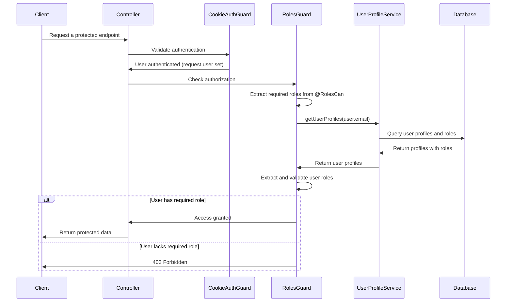

# Sistema de Autorización por Roles - RolesCan

## Índice

1. [Descripción General](#descripción-general)
2. [Arquitectura del Sistema](#arquitectura-del-sistema)
3. [Componentes Principales](#componentes-principales)
4. [Decorador @RolesCan](#decorador-rolescan)
5. [RolesGuard - Implementación](#rolesguard---implementación)
6. [Flujo de Autorización](#flujo-de-autorización)
7. [Integración con UserProfiles](#integración-con-userprofiles)
8. [Casos de Uso Prácticos](#casos-de-uso-prácticos)
9. [Configuración y Setup](#configuración-y-setup)
10. [Manejo de Errores](#manejo-de-errores)
11. [Testing](#testing)
12. [Mejores Prácticas](#mejores-prácticas)

## Descripción General

El sistema de autorización por roles implementa Control de Acceso Basado en Roles (RBAC - Role-Based Access Control) para proteger endpoints específicos basándose en los roles asignados a los usuarios. Este sistema trabaja en conjunto con el sistema de autenticación para proporcionar una capa adicional de seguridad.

### Características Principales

- **Decorador @RolesCan**: Sintaxis simple para proteger endpoints
- **RolesGuard**: Guard automático que valida roles
- **Integración dinámica**: Carga roles desde base de datos
- **Múltiples roles**: Soporte para múltiples roles por usuario
- **Logging completo**: Auditoría de intentos de acceso
- **Manejo de errores**: Respuestas detalladas de acceso denegado

## Arquitectura del Sistema

```
Roles Authorization System/
├── decorators/
│   └── rolesCan.decorator.ts    # Decorador para marcar roles requeridos
├── guards/
│   └── roles.guard.ts          # Guard que valida roles del usuario
├── interfaces/
│   └── userProfile.interface.ts # Interfaz para perfiles de usuario
└── integration/
    └── UserProfileService      # Servicio de perfiles y roles
```

### Flujo de Trabajo

```
1. Request → CookieAuthGuard (autenticación)
2. User authenticated → RolesGuard (autorización)
3. Extract required roles from @RolesCan decorator
4. Get user roles from UserProfileService
5. Validate user has required roles
6. Allow/Deny access
```

## Componentes Principales

### 1. Decorador @RolesCan

**Ubicación:** `src/modules/shared/infrastructure/decorators/rolesCan.decorator.ts`

```typescript
import { SetMetadata } from '@nestjs/common';

export const ROLES_KEY = 'roles';
export const RolesCan = (roles: string[]) => SetMetadata(ROLES_KEY, roles);
```

**Funcionalidad:**

- Define metadatos para los roles requeridos en un endpoint
- Utiliza el sistema de metadatos de NestJS
- Permite especificar múltiples roles

**Uso Básico:**

```typescript
@UseGuards(CookieAuthGuard, RolesGuard)
@RolesCan(['ADMIN'])
@Get('admin-only')
async adminEndpoint() {
    return { message: 'Solo administradores pueden ver esto' };
}

@RolesCan(['ADMIN', 'MANAGER'])
@Post('management')
async managementEndpoint() {
    return { message: 'Administradores y managers pueden acceder' };
}
```

### 2. RolesGuard - Implementación Detallada

**Ubicación:** `src/modules/shared/infrastructure/guards/roles.guard.ts`

```typescript
@Injectable()
export class RolesGuard implements CanActivate {
  private readonly logger = new Logger(RolesGuard.name);

  constructor(
    private reflector: Reflector,
    private moduleRef: ModuleRef,
  ) {}

  async canActivate(context: ExecutionContext): Promise<boolean> {
    // PASO 1: Extraer roles requeridos del decorador
    const requiredRoles = this.reflector.getAllAndOverride<string[]>(ROLES_KEY, [context.getHandler(), context.getClass()]);

    // PASO 2: Si no hay roles requeridos, permitir acceso
    if (!requiredRoles || requiredRoles.length === 0) {
      return true;
    }

    // PASO 3: Obtener usuario del request (establecido por CookieAuthGuard)
    const request = context.switchToHttp().getRequest();
    const user = request.user;

    this.logger.debug('Required Roles:', requiredRoles);
    this.logger.debug('User from token:', JSON.stringify(user, null, 2));

    // PASO 4: Validar que el usuario esté autenticado
    if (!user || !user.email) {
      throw new ForbiddenException('User not authenticated');
    }

    try {
      // PASO 5: Obtener servicio de perfiles de usuario
      const userProfileService = await this.getUserProfileService();

      if (!userProfileService) {
        this.logger.error('UserProfileService not available, denying access for security reasons');
        throw new ForbiddenException('Role service not available');
      }

      // PASO 6: Obtener perfiles y roles del usuario
      const userProfiles = await userProfileService.getUserProfiles(user.email);
      this.logger.debug('User profiles:', JSON.stringify(userProfiles, null, 2));

      // PASO 7: Extraer roles de los perfiles
      const userRoles = this.extractUserRoles(userProfiles);
      this.logger.debug('Extracted user roles:', userRoles);

      // PASO 8: Validar que el usuario tenga roles asignados
      if (userRoles.length === 0) {
        throw new ForbiddenException('User has no assigned roles');
      }

      // PASO 9: Verificar si el usuario tiene al menos uno de los roles requeridos
      const hasRequiredRole = requiredRoles.some((requiredRole) => userRoles.includes(requiredRole));

      if (!hasRequiredRole) {
        this.logger.warn(`Access denied for ${user.email}. Required roles: [${requiredRoles.join(', ')}]. User roles: [${userRoles.join(', ')}]`);
        throw new ForbiddenException('User does not have the required roles');
      }

      // PASO 10: Acceso concedido
      this.logger.debug(`Access granted for user: ${user.email}`);
      return true;
    } catch (error) {
      if (error instanceof ForbiddenException) {
        throw error;
      }
      this.logger.error('Error verifying user roles:', error);
      throw new ForbiddenException('Unable to verify user roles');
    }
  }

  // MÉTODO PRIVADO: Obtener servicio de perfiles dinámicamente
  private async getUserProfileService(): Promise<any> {
    try {
      // Intentar obtener por nombre de string primero
      try {
        return this.moduleRef.get('UserProfileService', { strict: false });
      } catch {
        // Fallback: importar dinámicamente la clase
        const { UserProfileService } = await import('../../../users/application/services/UserProfile.service');
        return this.moduleRef.get(UserProfileService, { strict: false });
      }
    } catch (error) {
      this.logger.warn('Could not resolve UserProfileService:', error.message);
      return null;
    }
  }

  // MÉTODO PRIVADO: Extraer roles de los perfiles de usuario
  private extractUserRoles(userProfiles: any[]): string[] {
    const roles: string[] = [];

    if (!userProfiles || !Array.isArray(userProfiles)) {
      return roles;
    }

    userProfiles.forEach((profile) => {
      if (profile.roles && Array.isArray(profile.roles)) {
        profile.roles.forEach((role) => {
          if (typeof role === 'string' && !roles.includes(role)) {
            roles.push(role);
          }
        });
      }
    });

    return roles;
  }
}
```

## Flujo de Autorización

### 1. Configuración de Endpoint Protegido

```typescript
@Controller('api/admin')
@UseGuards(CookieAuthGuard, RolesGuard) // Aplicar a todo el controller
export class AdminController {
  @RolesCan(['ADMIN'])
  @Get('users')
  async getAllUsers() {
    // Solo usuarios con rol ADMIN pueden acceder
    return await this.userService.getAllUsers();
  }

  @RolesCan(['ADMIN', 'SUPER_ADMIN'])
  @Delete('users/:id')
  async deleteUser(@Param('id') id: string) {
    // Solo ADMIN o SUPER_ADMIN pueden eliminar usuarios
    return await this.userService.deleteUser(id);
  }

  @RolesCan(['MANAGER', 'ADMIN'])
  @Get('reports')
  async getReports() {
    // Managers y Admins pueden ver reportes
    return await this.reportService.getAll();
  }
}
```

### 2. Estructura de Perfiles de Usuario

```typescript
// Ejemplo de estructura que retorna UserProfileService.getUserProfiles()
[
  {
    id: 1,
    name: 'Administrador del Sistema',
    description: 'Perfil con acceso completo',
    roles: ['ADMIN', 'USER_MANAGER', 'SYSTEM_CONFIG'],
  },
  {
    id: 2,
    name: 'Manager de Operaciones',
    description: 'Gestión de operaciones diarias',
    roles: ['MANAGER', 'OPERATIONS', 'REPORTS_VIEW'],
  },
];
```

### 3. Proceso de Validación



## Integración con UserProfiles

### 1. Servicio de Perfiles de Usuario

```typescript
// UserProfileService (referencia)
@Injectable()
export class UserProfileService {
  constructor(private readonly userRepository: UserRepository) {}

  async getUserProfiles(email: string): Promise<UserProfile[]> {
    // Obtener usuario por email
    const user = await this.userRepository.find(email);
    if (!user) {
      throw new Error('User not found');
    }

    // Obtener perfiles y roles del usuario
    const userProfiles = await this.userRepository.findUserProfilesAndRoles(user.getId());

    return userProfiles.map((profile) => ({
      id: profile.id,
      name: profile.name,
      description: profile.description,
      roles: profile.roles || [],
    }));
  }
}
```

### 2. Estructura en Base de Datos

```sql
-- Tabla de usuarios
users (id, email, name, ...)

-- Tabla de perfiles
profiles (id, name, description, ...)

-- Tabla de roles
roles (id, name, description, ...)

-- Relación usuarios-perfiles
user_profiles (user_id, profile_id)

-- Relación perfiles-roles
profile_roles (profile_id, role_id)
```

## Casos de Uso Prácticos

### 1. Controller con Múltiples Niveles de Acceso

```typescript
@Controller('api/content')
export class ContentController {
  // Público - sin guards
  @Get('public')
  async getPublicContent() {
    return await this.contentService.getPublic();
  }

  // Solo autenticado - solo CookieAuthGuard
  @UseGuards(CookieAuthGuard)
  @Get('user')
  async getUserContent(@Req() request: Request) {
    return await this.contentService.getUserContent(request.user.email);
  }

  // Solo admins - ambos guards
  @UseGuards(CookieAuthGuard, RolesGuard)
  @RolesCan(['ADMIN'])
  @Get('admin')
  async getAdminContent() {
    return await this.contentService.getAdminContent();
  }

  // Múltiples roles permitidos
  @UseGuards(CookieAuthGuard, RolesGuard)
  @RolesCan(['ADMIN', 'CONTENT_MANAGER', 'EDITOR'])
  @Post('create')
  async createContent(@Body() content: CreateContentDto) {
    return await this.contentService.create(content);
  }
}
```

### 2. Guards a Nivel de Controller

```typescript
@Controller('api/management')
@UseGuards(CookieAuthGuard, RolesGuard) // Aplicar a todos los endpoints
@RolesCan(['MANAGER', 'ADMIN']) // Roles por defecto para todo el controller
export class ManagementController {
  @Get('dashboard')
  async getDashboard() {
    // Hereda los roles del controller: ['MANAGER', 'ADMIN']
    return await this.dashboardService.getManagementDashboard();
  }

  @RolesCan(['ADMIN']) // Override: solo ADMIN para este endpoint
  @Delete('reset-system')
  async resetSystem() {
    // Solo ADMIN puede resetear el sistema
    return await this.systemService.reset();
  }
}
```

### 3. Verificación Programática de Roles

```typescript
@Injectable()
export class SomeService {
  constructor(private readonly userProfileService: UserProfileService) {}

  async performSensitiveOperation(userEmail: string, operation: string) {
    // Verificar roles programáticamente
    const userProfiles = await this.userProfileService.getUserProfiles(userEmail);
    const userRoles = this.extractRoles(userProfiles);

    if (!userRoles.includes('ADMIN') && !userRoles.includes('SUPER_USER')) {
      throw new ForbiddenException('Insufficient permissions for this operation');
    }

    // Proceder con la operación
    return await this.performOperation(operation);
  }

  private extractRoles(profiles: any[]): string[] {
    return profiles.flatMap((profile) => profile.roles || []);
  }
}
```

## Configuración y Setup

### 1. Registro Global de Guards

```typescript
// app.module.ts o main.ts
import { APP_GUARD } from '@nestjs/core';
import { RolesGuard } from './shared/infrastructure/guards/roles.guard';

@Module({
  providers: [
    // Registrar RolesGuard como guard global (opcional)
    {
      provide: APP_GUARD,
      useClass: RolesGuard,
    },
  ],
})
export class AppModule {}
```

### 2. Configuración de Módulos

```typescript
// shared.module.ts
@Module({
  providers: [
    RolesGuard,
    // Otros providers
  ],
  exports: [
    RolesGuard,
    // Otros exports
  ],
})
export class SharedModule {}
```

### 3. Importación en Módulos que lo Usan

```typescript
// admin.module.ts
@Module({
  imports: [SharedModule], // Para acceder a RolesGuard
  controllers: [AdminController],
  providers: [AdminService],
})
export class AdminModule {}
```

## Manejo de Errores

### 1. Tipos de Errores

```typescript
// Errores comunes en RolesGuard
export class AuthorizationErrors {
  // Usuario no autenticado
  static USER_NOT_AUTHENTICATED = 'User not authenticated';

  // Usuario sin roles asignados
  static NO_ROLES_ASSIGNED = 'User has no assigned roles';

  // Usuario sin el rol requerido
  static INSUFFICIENT_PERMISSIONS = 'User does not have the required roles';

  // Servicio de roles no disponible
  static ROLE_SERVICE_UNAVAILABLE = 'Role service not available';
}
```

### 2. Respuestas de Error

```typescript
// Ejemplo de respuesta de error 403
{
    "success": false,
    "message": "Access denied",
    "errors": [
        {
            "message": "User does not have the required roles"
        }
    ],
    "statusCode": 403,
    "timestamp": "2025-08-18T10:30:00.000Z"
}
```

### 3. Manejo de Errores en Frontend

```javascript
async function callProtectedEndpoint() {
  try {
    const response = await fetch('/api/admin/users', {
      method: 'GET',
      credentials: 'include',
    });

    if (response.status === 403) {
      const errorData = await response.json();
      showAccessDeniedMessage(errorData.message);
      return;
    }

    if (!response.ok) {
      throw new Error('Network error');
    }

    const data = await response.json();
    return data;
  } catch (error) {
    console.error('Error calling protected endpoint:', error);
    showErrorMessage('Error accessing resource');
  }
}

function showAccessDeniedMessage(message) {
  // Mostrar mensaje amigable al usuario
  alert('No tienes permisos para acceder a este recurso');
  // Opcional: redirigir a página de inicio
  window.location.href = '/dashboard';
}
```

## Testing

### 1. Test del RolesGuard

```typescript
// roles.guard.spec.ts
describe('RolesGuard', () => {
  let guard: RolesGuard;
  let reflector: Reflector;
  let moduleRef: ModuleRef;
  let mockUserProfileService: jest.Mocked<UserProfileService>;

  beforeEach(async () => {
    const module: TestingModule = await Test.createTestingModule({
      providers: [
        RolesGuard,
        {
          provide: Reflector,
          useValue: {
            getAllAndOverride: jest.fn(),
          },
        },
        {
          provide: ModuleRef,
          useValue: {
            get: jest.fn(),
          },
        },
      ],
    }).compile();

    guard = module.get<RolesGuard>(RolesGuard);
    reflector = module.get<Reflector>(Reflector);
    moduleRef = module.get<ModuleRef>(ModuleRef);
  });

  it('should allow access when no roles are required', async () => {
    // Arrange
    const context = createMockExecutionContext();
    jest.spyOn(reflector, 'getAllAndOverride').mockReturnValue(null);

    // Act
    const result = await guard.canActivate(context);

    // Assert
    expect(result).toBe(true);
  });

  it('should allow access when user has required role', async () => {
    // Arrange
    const context = createMockExecutionContext({
      user: { email: 'admin@test.com' },
    });

    jest.spyOn(reflector, 'getAllAndOverride').mockReturnValue(['ADMIN']);

    mockUserProfileService = {
      getUserProfiles: jest.fn().mockResolvedValue([{ id: 1, name: 'Admin', roles: ['ADMIN', 'USER'] }]),
    };

    jest.spyOn(moduleRef, 'get').mockReturnValue(mockUserProfileService);

    // Act
    const result = await guard.canActivate(context);

    // Assert
    expect(result).toBe(true);
  });

  it('should deny access when user lacks required role', async () => {
    // Arrange
    const context = createMockExecutionContext({
      user: { email: 'user@test.com' },
    });

    jest.spyOn(reflector, 'getAllAndOverride').mockReturnValue(['ADMIN']);

    mockUserProfileService = {
      getUserProfiles: jest.fn().mockResolvedValue([{ id: 1, name: 'User', roles: ['USER'] }]),
    };

    jest.spyOn(moduleRef, 'get').mockReturnValue(mockUserProfileService);

    // Act & Assert
    await expect(guard.canActivate(context)).rejects.toThrow(ForbiddenException);
  });
});

function createMockExecutionContext(requestData = {}): ExecutionContext {
  return {
    switchToHttp: () => ({
      getRequest: () => requestData,
    }),
    getHandler: () => ({}),
    getClass: () => ({}),
  } as ExecutionContext;
}
```

### 2. Test de Integración

```typescript
// roles-integration.spec.ts
describe('Roles Integration Tests', () => {
  let app: INestApplication;
  let userRepository: UserRepository;

  beforeEach(async () => {
    const moduleFixture: TestingModule = await Test.createTestingModule({
      imports: [AppModule],
    }).compile();

    app = moduleFixture.createNestApplication();
    userRepository = moduleFixture.get<UserRepository>('UserRepository');
    await app.init();
  });

  it('should allow admin access to admin endpoint', async () => {
    // Setup: crear usuario admin
    const adminUser = await createTestUser({
      email: 'admin@test.com',
      roles: ['ADMIN'],
    });

    // Login para obtener cookies
    const loginResponse = await request(app.getHttpServer())
      .post('/api/auth/login')
      .send({
        emailuser: 'admin@test.com',
        password: 'password123',
      })
      .expect(200);

    const cookies = loginResponse.headers['set-cookie'];

    // Test: acceder a endpoint de admin
    const response = await request(app.getHttpServer()).get('/api/admin/users').set('Cookie', cookies).expect(200);

    expect(response.body.success).toBe(true);
  });

  it('should deny user access to admin endpoint', async () => {
    // Setup: crear usuario regular
    const regularUser = await createTestUser({
      email: 'user@test.com',
      roles: ['USER'],
    });

    // Login
    const loginResponse = await request(app.getHttpServer())
      .post('/api/auth/login')
      .send({
        emailuser: 'user@test.com',
        password: 'password123',
      })
      .expect(200);

    const cookies = loginResponse.headers['set-cookie'];

    // Test: intentar acceder a endpoint de admin
    await request(app.getHttpServer()).get('/api/admin/users').set('Cookie', cookies).expect(403);
  });
});
```

## Mejores Prácticas

### 1. Diseño de Roles

```typescript
// Definir roles como constantes para evitar errores de tipeo
export const ROLES = {
    // Roles de sistema
    SUPER_ADMIN: 'SUPER_ADMIN',
    ADMIN: 'ADMIN',

    // Roles funcionales
    USER_MANAGER: 'USER_MANAGER',
    CONTENT_MANAGER: 'CONTENT_MANAGER',
    OPERATIONS_MANAGER: 'OPERATIONS_MANAGER',

    // Roles de usuario
    PREMIUM_USER: 'PREMIUM_USER',
    BASIC_USER: 'BASIC_USER',

    // Roles especializados
    AUDITOR: 'AUDITOR',
    SUPPORT: 'SUPPORT',
    ANALYST: 'ANALYST',
} as const;

// Usar en decoradores
@RolesCan([ROLES.ADMIN, ROLES.USER_MANAGER])
```

### 2. Jerarquía de Roles

```typescript
// Definir jerarquía de roles
export const ROLE_HIERARCHY = {
  [ROLES.SUPER_ADMIN]: [
    ROLES.ADMIN,
    ROLES.USER_MANAGER,
    ROLES.CONTENT_MANAGER,
    ROLES.OPERATIONS_MANAGER,
    ROLES.AUDITOR,
    ROLES.SUPPORT,
    ROLES.ANALYST,
    ROLES.PREMIUM_USER,
    ROLES.BASIC_USER,
  ],
  [ROLES.ADMIN]: [ROLES.USER_MANAGER, ROLES.CONTENT_MANAGER, ROLES.PREMIUM_USER, ROLES.BASIC_USER],
  [ROLES.USER_MANAGER]: [ROLES.BASIC_USER],
  [ROLES.PREMIUM_USER]: [ROLES.BASIC_USER],
};

// Función helper para verificar jerarquía
export function hasRoleOrHigher(userRoles: string[], requiredRole: string): boolean {
  // Verificar si el usuario tiene el rol exacto
  if (userRoles.includes(requiredRole)) {
    return true;
  }

  // Verificar jerarquía
  for (const userRole of userRoles) {
    const inheritedRoles = ROLE_HIERARCHY[userRole] || [];
    if (inheritedRoles.includes(requiredRole)) {
      return true;
    }
  }

  return false;
}
```

### 3. Logging y Auditoría

```typescript
// Enhanced RolesGuard con auditoría completa
async canActivate(context: ExecutionContext): Promise<boolean> {
    const startTime = Date.now();
    const request = context.switchToHttp().getRequest();
    const endpoint = `${request.method} ${request.url}`;

    try {
        // ... lógica de validación ...

        this.logger.info(`ACCESS_GRANTED: ${user.email} → ${endpoint} [${userRoles.join(',')}]`);
        return true;

    } catch (error) {
        const duration = Date.now() - startTime;
        this.logger.warn(`ACCESS_DENIED: ${user?.email || 'unknown'} → ${endpoint} - ${error.message} (${duration}ms)`);
        throw error;
    }
}
```

### 4. Configuración Flexible

```typescript
// Configuración de roles desde base de datos o archivo de configuración
@Injectable()
export class RoleConfigService {
  async getRequiredRoles(endpoint: string): Promise<string[]> {
    // Obtener roles requeridos desde configuración dinámica
    const config = await this.configRepository.findByEndpoint(endpoint);
    return config?.requiredRoles || [];
  }
}

// Guard mejorado con configuración dinámica
@Injectable()
export class EnhancedRolesGuard implements CanActivate {
  constructor(
    private reflector: Reflector,
    private moduleRef: ModuleRef,
    private roleConfigService: RoleConfigService,
  ) {}

  async canActivate(context: ExecutionContext): Promise<boolean> {
    // Obtener roles del decorador
    let requiredRoles = this.reflector.getAllAndOverride<string[]>(ROLES_KEY, [context.getHandler(), context.getClass()]);

    // Si no hay roles en decorador, buscar en configuración
    if (!requiredRoles || requiredRoles.length === 0) {
      const request = context.switchToHttp().getRequest();
      const endpoint = `${request.method} ${request.route?.path || request.url}`;
      requiredRoles = await this.roleConfigService.getRequiredRoles(endpoint);
    }

    // Continuar con validación normal...
  }
}
```

Este sistema de autorización por roles proporciona una base sólida y flexible para controlar el acceso a recursos en aplicaciones NestJS, con logging completo, manejo de errores robusto, y facilidad de testing.
